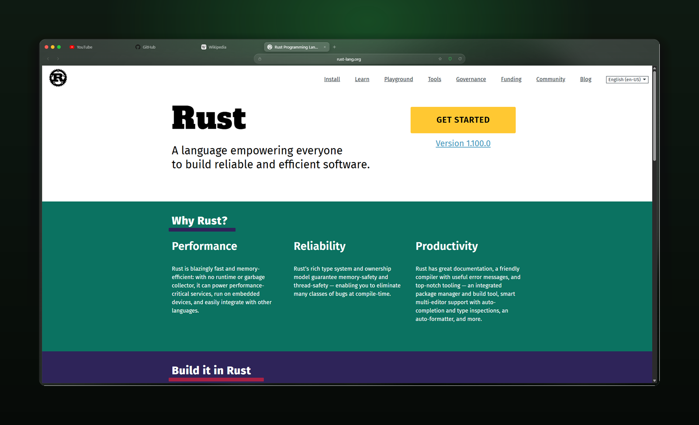

# 🍃 Leaf

**Ein schlanker, schneller Browser für Windows – geschrieben in Rust.**
Kein Bloat, kein Konto, keine Telemetrie. Nur das, was ein Browser wirklich braucht.



## Warum Leaf?

Die meisten Browser schleppen Shopping-Assistenten, Sync, News-Feeds und Dutzende Hintergrunddienste mit. Leaf lässt das alles weg und konzentriert sich auf drei Dinge: **schnell**, **wenig RAM**, **gut aussehen**.

- **~1 MB** große `.exe`, die App selbst braucht **~4 MB RAM**
- **0–1 % CPU** im Leerlauf
- Hintergrund-Tabs werden **eingefroren** und nach 10 min komplett **entladen**
- Neue Tabs kosten **gar keinen** WebView, bis du eine Seite öffnest

## Funktionen

- **Liquid-Glass-Design** – dunkel, grün, minimalistisch; die Oberfläche zeigt deinen Desktop-Hintergrund unscharf durch
- **Werbe- & Tracker-Blocker** eingebaut (inkl. YouTube-Werbung überspringen), erweiterbar über eine eigene Liste
- **Tabs** mit Favicons, per Ziehen sortierbar, Ton-Anzeige & Stummschalten
- **Verlauf mit Vorschlägen** direkt in der Adressleiste, Google als Suchmaschine
- **Favoriten** auf der Startseite
- **Sitzung wiederherstellen** – Tabs kommen nach dem Neustart zurück, du bleibst überall angemeldet
- **Passwörter & Formulare** werden gespeichert und automatisch ausgefüllt
- **Downloads**, Vollbild, Zoom, Suchen, Drucken
- Eigene Fehlerseite, Sicherheits-Anzeige bei unverschlüsselten Seiten
- Kann als **Standardbrowser** gesetzt werden

## Tastenkürzel

| Kürzel | Aktion |
|---|---|
| `Strg+T` / `Strg+W` | Neuer Tab / Tab schließen |
| `Strg+Umschalt+T` | Geschlossenen Tab wiederherstellen |
| `Strg+Tab` / `Strg+1…9` | Tab wechseln |
| `Strg+L` | Adressleiste |
| `Strg+D` | Favorit hinzufügen / entfernen |
| `Strg+Umschalt+J` | Downloads |
| `F5` / `F11` | Neu laden / Vollbild |

## Installieren

Voraussetzungen: Windows 10/11 (WebView2 ist vorinstalliert), [Rust](https://rustup.rs) und die Visual Studio Build Tools (C++).

```powershell
git clone https://github.com/hanitazu/leaf.git
cd leaf
cargo build --release
copy target\release\leaf.exe .
.\install.ps1
```

`install.ps1` installiert Leaf für den aktuellen Benutzer (ohne Admin-Rechte), legt eine Startmenü-Verknüpfung an und registriert Leaf als Browser. Danach öffnet sich die Windows-Seite, auf der du Leaf als Standard festlegen kannst.
Deinstallieren: `.\install.ps1 -Uninstall`

## Technik

- **Rust** mit [`tao`](https://github.com/tauri-apps/tao) (Fenster) und [`wry`](https://github.com/tauri-apps/wry) (WebView)
- Rendering über **WebView2** – die Chromium-Engine, die Windows schon mitbringt, deshalb ist Leaf so klein
- Werbeblocker, Tab-Pausierung, Cookies & Favicons direkt über die WebView2-COM-API
- Oberfläche in einer einzigen HTML-Datei, ohne Frameworks

Alle Daten (Verlauf, Favoriten, Sitzung) bleiben lokal unter `%LOCALAPPDATA%\Leaf`.

## Über das Projekt

Leaf ist mein eigenes Projekt – Idee, Design und Richtung kommen von mir. Beim Programmieren habe ich mir von KI helfen lassen.

## Lizenz

[MIT](LICENSE)
